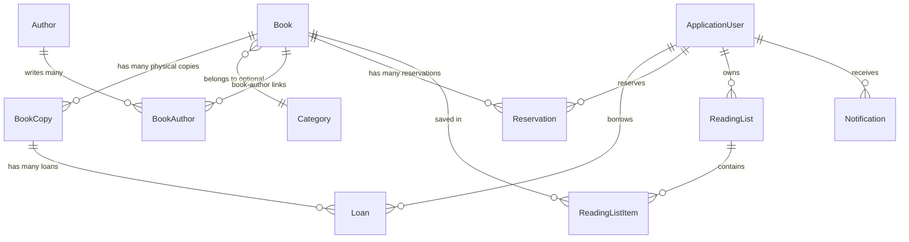

# FLOWCHARTS.md — Milestone 1: Domain Entities and Database Foundation

## Entity Relationship Diagram (Mermaid)



## Database Initialization Flow

```mermaid
flowchart TD
    A[App starts] --> B[Program.cs: AddDbContext + AddIdentity]
    B --> C[Create scope]
    C --> D[context.Database.Migrate()]
    D --> E[Create roles if missing: Administrator, Librarian, Borrower]
    E --> F[Create users if missing: admin, librarian, borrower]
    F --> G[App listens on http://localhost:5288]
    G --> H[Ready]
```

## Migration Flow

```mermaid
flowchart TD
    A[dotnet ef migrations add InitialCreate]
    B[Migration snapshot in Persistence/Migrations/]
    C[App start → Database.Migrate()]
    D[SQL Server LocalDB: SinopLibraryDb created]
    E[HasData seed rows inserted: categories, authors, books, copies]
    A --> B --> C --> D --> E