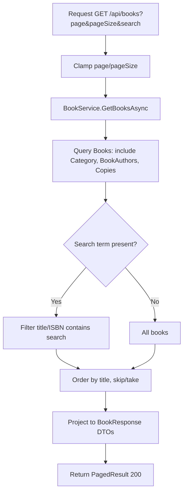
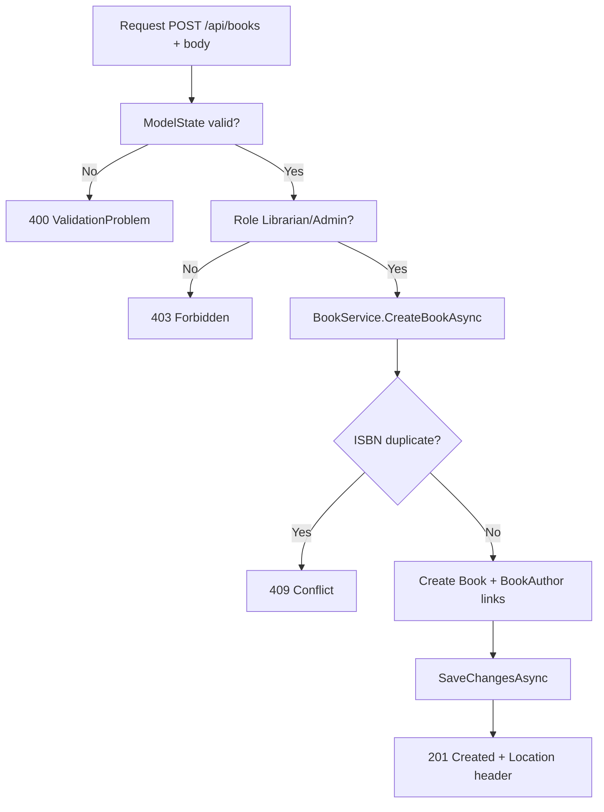

# FLOWCHARTS.md — Milestone 4: Book Catalog Web API

## GET /api/books Flow



## POST /api/books Flow



## DELETE /api/books/{id} Flow

```mermaid
flowchart TD
    A[Request DELETE /api/books/{id}] --> B[Role Librarian/Admin?]
    B -->|No| C[403 Forbidden]
    B -->|Yes| D[BookService.ArchiveBookAsync]
    D --> E[Load book + copies + loans + reservations]
    E --> F{Active loan or queued reservation?}
    F -->|Yes| G[409 Conflict]
    F -->|No| H[Remove book (copies cascade-delete)]
    H --> I[SaveChangesAsync]
    I --> J[204 No Content]
```

## Error Handling Flow

```mermaid
flowchart TD
    A[Controller throws exception] --> B{Exception type?}
    B -->|InvalidOperationException| C[ExceptionMiddleware / controller catch → 409]
    B -->|NotFound (null result)| D[Controller → 404]
    B -->|Unhandled| E[ExceptionMiddleware → 500 problem+json]
    B -->|Invalid model| F[Controller → 400 ValidationProblem]