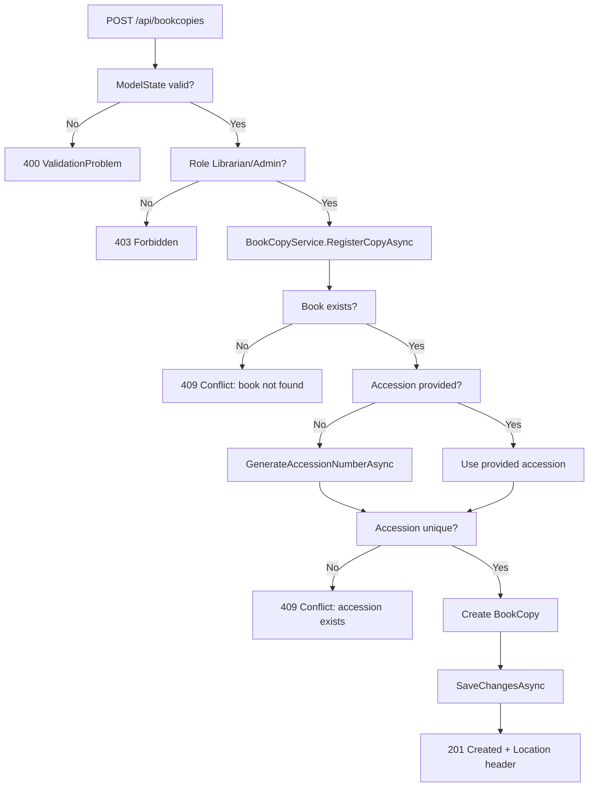

# FLOWCHARTS.md — Milestone 6: Physical Inventory Management

## Register Copy Flow



## Status Update Flow

```mermaid
flowchart TD
    A[PATCH /api/bookcopies/{id}/status] --> B[ModelState valid?]
    B -->|No| C[400 ValidationProblem]
    B -->|Yes| D[Role Librarian/Admin?]
    D -->|No| E[403 Forbidden]
    D -->|Yes| F[BookCopyService.UpdateCopyStatusAsync]
    F --> G[Copy exists?]
    G -->|No| H[404 Not Found]
    G -->|Yes| I{Valid transition?}
    I -->|No| J[409 Conflict]
    I -->|Yes| K[Update Status]
    K --> L[SaveChangesAsync]
    L --> M[200 OK]
```

## Accession Generation Flow

```mermaid
flowchart TD
    A[GET /api/bookcopies/accession-number/{bookId}] --> B[Book exists?]
    B -->|No| C[409 Conflict]
    B -->|Yes| D[Prefix = LIB-{bookId:D4}]
    D --> E[Find existing accessions with prefix]
    E --> F[Next available NN suffix]
    F --> G[Return LIB-####-NN]
```
