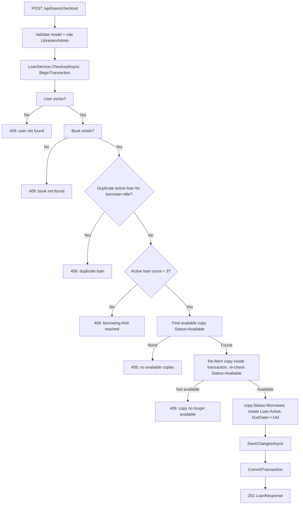
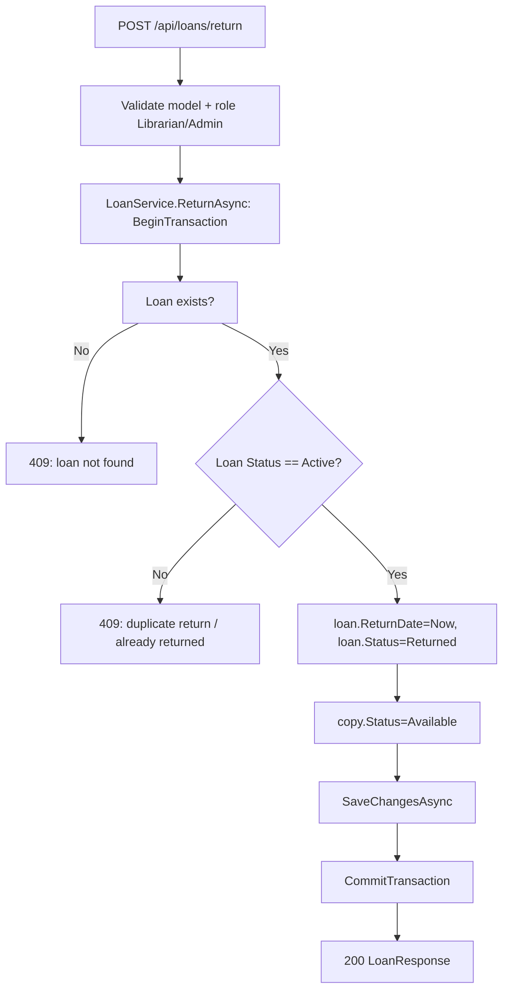

# FLOWCHARTS.md — Milestone 7: Borrowing and Return Operations

## Checkout Flow (Transactional)



## Return Flow (Transactional)



## Eligibility Flow

```mermaid
flowchart TD
    A[GET /api/loans/eligibility/{userId}] --> B[ValidateBorrowerEligibilityAsync]
    B --> C[User exists?]
    C -->|No| D[eligible: false]
    C -->|Yes| E[Active loan count < 3?]
    E -->|Yes| F[eligible: true]
    E -->|No| G[eligible: false]
    F --> H[200 {userId, eligible, maxActiveLoans:3}]
    G --> H