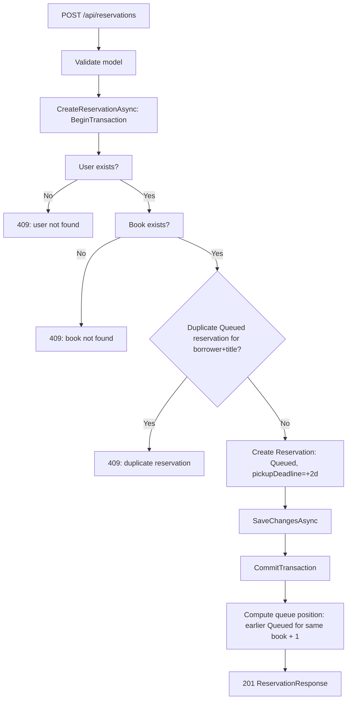
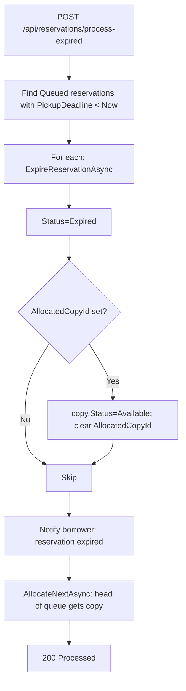

# FLOWCHARTS.md — Milestone 8: Reservation System

## Create Reservation Flow



## Cancel Reservation Flow

```mermaid
flowchart TD
    A[POST /api/reservations/{id}/cancel?userId=X] --> B[Reservation exists?]
    B -->|No| C[404]
    B -->|Yes| D{userId matches reservation owner?}
    D -->|No| E[404: not found / not owned]
    D -->|Yes| F{Status Queued or ReadyForPickup?}
    F -->|No| G[404: cannot cancel]
    F -->|Yes| H[Status=Cancelled]
    H --> I{AllocatedCopyId set?}
    I -->|Yes| J[copy.Status=Available if Reserved; clear AllocatedCopyId]
    I -->|No| K[Skip]
    J --> K
    K --> L[SaveChangesAsync]
    L --> M[AllocateNextAsync(bookId): head of queue gets next Available copy]
    M --> N[200 Cancelled]
```

## Expire Reservation Flow



## Allocate Returned Copy Flow

```mermaid
flowchart TD
    A[POST /api/reservations/{bookId}/allocate-returned-copy?copyId=X] --> B[copy exists AND copy.Status==Available?]
    B -->|No| C[409: copy not available]
    B -->|Yes| D[Find head-of-queue Queued reservation for bookId (earliest ReservedAt)]
    D -->|None| E[false: no queue; copy stays Available]
    D -->|Found| F[copy.Status=Reserved]
    F --> G[reservation.Status=ReadyForPickup, AllocatedCopyId=copy.Id, pickupDeadline=+2d]
    G --> H[SaveChangesAsync]
    H --> I[Notify borrower: ready for pickup]
    I --> J[200 Allocated]
```

## Queue Ordering (First-Come, First-Served)

```mermaid
flowchart TD
    A[Multiple Queued reservations for same book] --> B[Order by ReservedAt ascending]
    B --> C[Earliest = head of queue (position 1)]
    C --> D[AllocateNextAsync picks head when copy Available]
    D --> E[Copy allocated to first borrower who reserved]