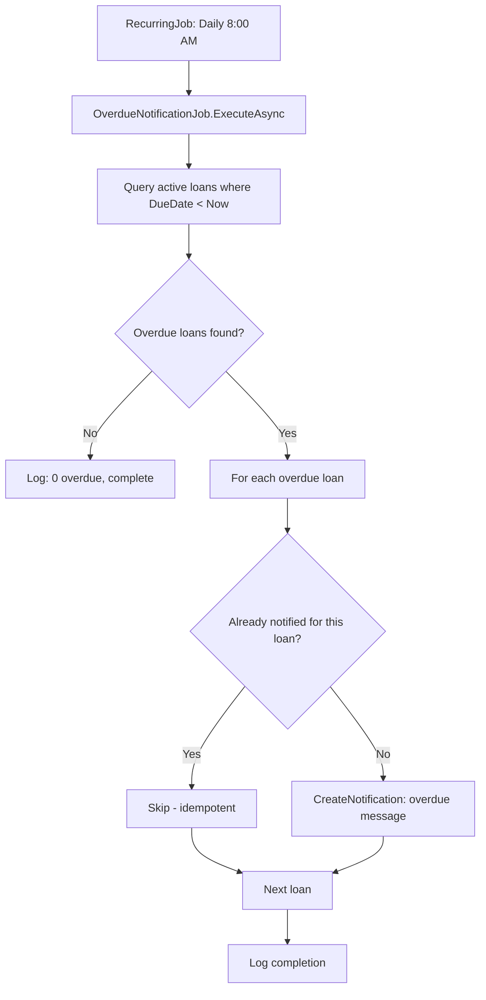
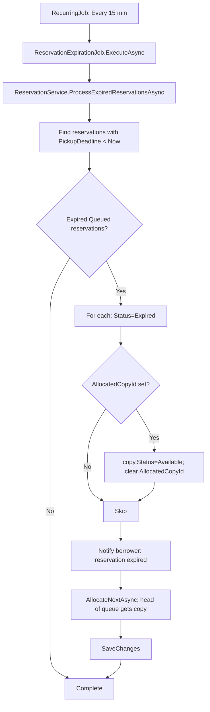

# FLOWCHARTS.md — Milestone 10: Hangfire and Background Jobs

## Overdue Notification Job Flow



## Reservation Expiration Job Flow



## Hangfire Dashboard Authorization

```mermaid
flowchart TD
    A[Request /hangfire] --> B[User authenticated?]
    B -->|No| C[401 Unauthorized]
    B -->|Yes| D{User in Administrator role?}
    D -->|No| E[401 Unauthorized / access denied]
    D -->|Yes| F[Hangfire Dashboard displayed]