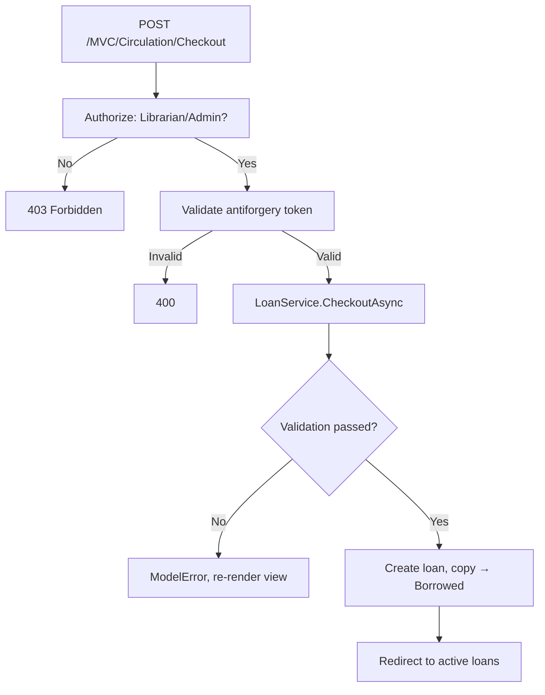
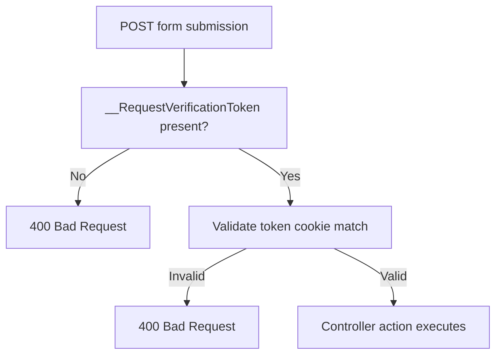

# FLOWCHARTS.md — Milestone 11: MVC Administrative Dashboard

## MVC Request Flow

```mermaid
flowchart TD
    A[Browser request /MVC/Books] --> B[Area route matches {area:exists}]
    B --> C[BooksController.Index (Area MVC)]
    C --> D[Authorize: user authenticated?]
    D -->|No| E[302 to /Account/Login]
    D -->|Yes| F[BookService.GetBooksAsync]
    F --> G[Query SQL Server: Books + copies + authors]
    G --> H[Render Index.cshtml with PagedResult]
    H --> I[200 HTML response]
```

## Checkout Flow (Circulation)



## Antiforgery Protection



## Role Authorization

```mermaid
flowchart TD
    A[Request to role-restricted page] --> B[User authenticated?]
    B -->|No| C[302 to login]
    B -->|Yes| D{User in required role?}
    D -->|No| E[403 Forbidden / 404]
    D -->|Yes| F[Page renders]