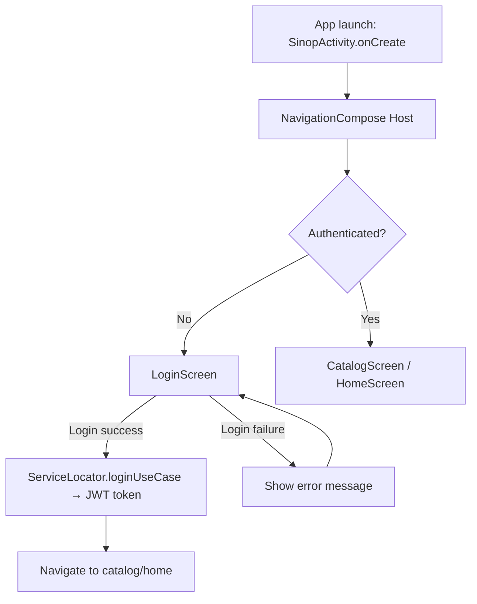
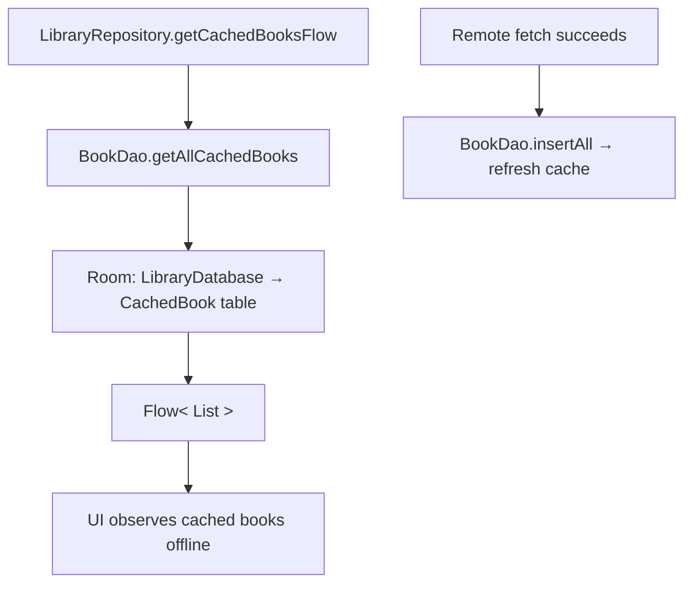

# FLOWCHARTS.md — Milestone 12: Android Foundation and Networking

## App Launch → Login → Navigation



## Login Flow

```mermaid
flowchart TD
    A[User enters email + password] --> B[Tap Login]
    B --> C[scope.launch { LoginUseCase.invoke(email, password) }]
    C --> D{result.isSuccess?}
    D -->|Yes| E[onLoginSuccess() → navigate to catalog]
    D -->|No| F[error = result.exceptionOrNull()?.message]
    F --> G[Show error Text in red]
```

## Catalog Data Flow

```mermaid
flowchart TD
    A[CatalogScreen composes] --> B[Tap Search]
    B --> C[GetBooksUseCase.invoke(authHeader, query)]
    C --> D[LibraryRepository → Retrofit API call]
    D --> E[Web API /api/books → JSON PagedResult]
    E --> F[Map DTO → domain Book]
    F --> G[LazyColumn renders book cards]
    G --> H[Tap book → BookDetailScreen]
```

## Room Cache Flow (planned, not yet wired)



## Navigation Flow

```mermaid
flowchart TD
    A[SinopActivity NavHost] --> B[route "login"]
    A --> C[route "catalog"]
    A --> D[route "home"]
    A --> E[route "bookdetail/{bookId}"]
    A --> F[route "mybooks"]
    A --> G[route "reservations"]
    A --> H[route "readinglists"]
    A --> I[route "notifications"]
    A --> J[route "profile"]
    B -->|onLoginSuccess| C
    C -->|onBookClick| D
    Any -->|onLogout| B
```
