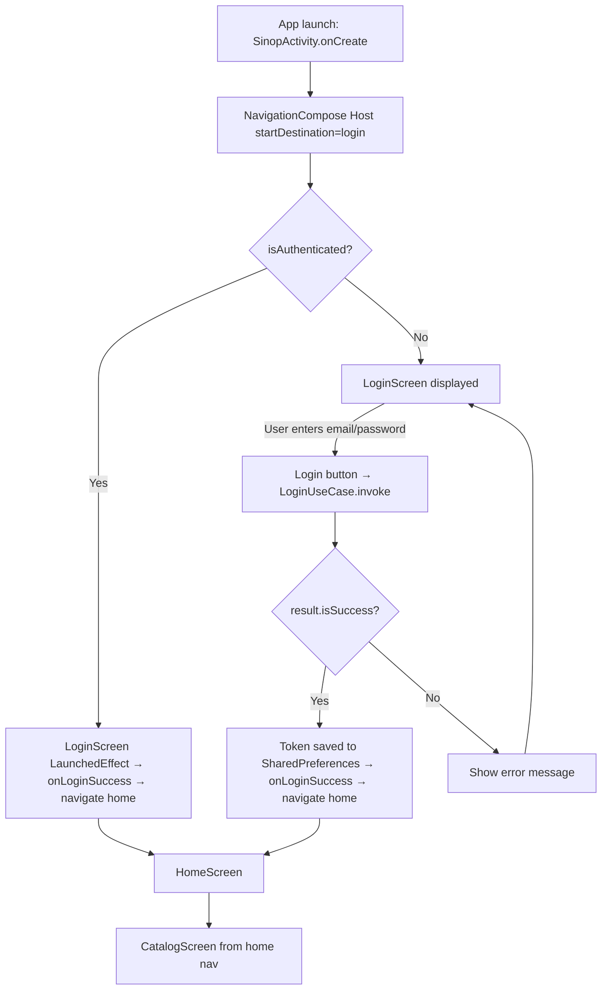

# FLOWCHARTS.md — Milestone 13: Android Authentication and Catalog

## App Start → Auth → Catalog



## Login Flow

```mermaid
flowchart TD
    A[Email + password TextFields] --> B[Tap Login]
    B --> C[isLoading = true]
    C --> D[scope.launch { LoginUseCase.invoke(email, password) }]
    D --> E{result.isSuccess?}
    E -->|Yes| F[_authState = Authenticated; token saved to prefs]
    F --> G[onLoginSuccess() → navigate home]
    E -->|No| H[error = exception message]
    H --> I[Show red error Text]
    I --> J[isLoading = false]
    J --> A
    G --> J
```

## Catalog Data Flow (online)

```mermaid
flowchart TD
    A[CatalogScreen: Search button tapped] --> B[isLoading = true]
    B --> C[GetBooksUseCase.invoke(searchQuery)]
    C --> D[LibraryRepository.getBooks → Retrofit GET /api/books]
    D --> E[Web API returns PagedResult<BookResponse> JSON]
    E --> F[Map DTO → domain Book list]
    F --> G[books = fetched list]
    G --> H[cacheBooks → Room CachedBook table]
    H --> I[isLoading = false; LazyColumn renders book cards]
    I --> J[Tap book → navigate bookdetail/{id}]
```

## Catalog Data Flow (offline / API failure)

```mermaid
flowchart TD
    A[API call fails or unreachable] --> B{cachedBooks non-empty?}
    B -->|Yes| C[books = cached books]
    C --> D[error = "Showing cached results (offline)."]
    D --> E[LazyColumn renders cached books]
    B -->|No| F[error = failure message]
    F --> G[books = empty]
```

## Book Details Flow

```mermaid
flowchart TD
    A[BookDetailScreen: LaunchedEffect(bookId)] --> B[isLoading = true]
    B --> C[GetBookDetailsUseCase.invoke(bookId)]
    C --> D[LibraryRepository.getBookDetails → Retrofit GET /api/books/{id}]
    D --> E[Web API returns BookDetailsResponse JSON]
    E --> F[Map DTO → domain Book incl. copies/availability]
    F --> G[book = result; isLoading = false]
    G --> H[Render title, ISBN, summary, authors, category, copies, availability]
```

## Room Cache Flow

```mermaid
flowchart TD
    A[CatalogScreen first composition] --> B[getCachedBooksFlow() collectAsState]
    B --> C{cached books non-empty?}
    C -->|Yes| D[display cached books immediately offline-first]
    C -->|No| E[wait for search/API fetch]
    F[Successful API fetch] --> G[cacheBooks → Room insertAll]
    G --> H[subsequent launches show cached books]
```

## Authentication State Flow

```mermaid
flowchart TD
    A[AuthRepository._authState MutableStateFlow] --> B[Unauthenticated]
    A --> C[Authenticated(token, email, roles)]
    B -->|login success| C
    C -->|logout / token cleared| B
    C -->|LoginScreen LaunchedEffect| D[Skip login, go home]
```
