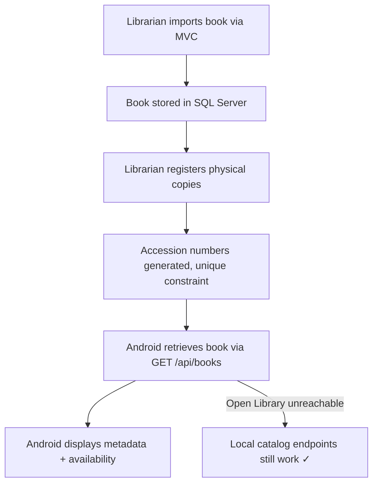
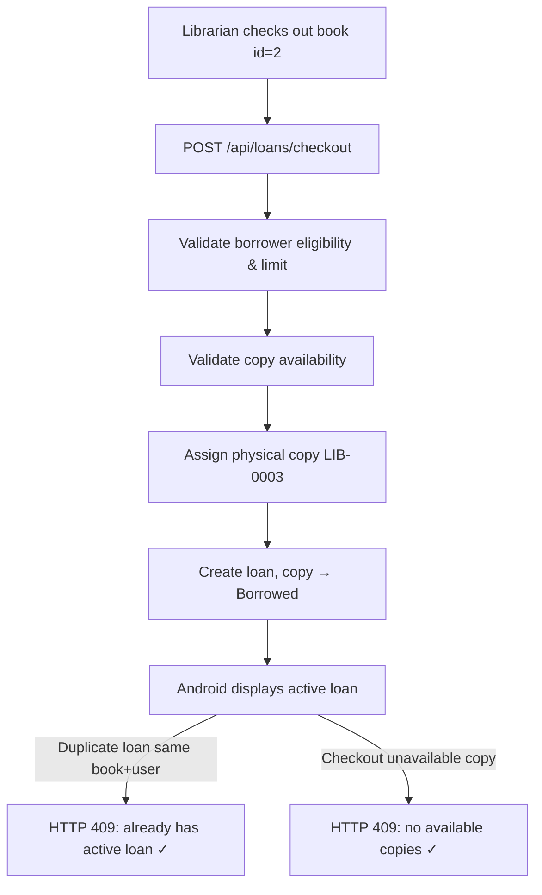
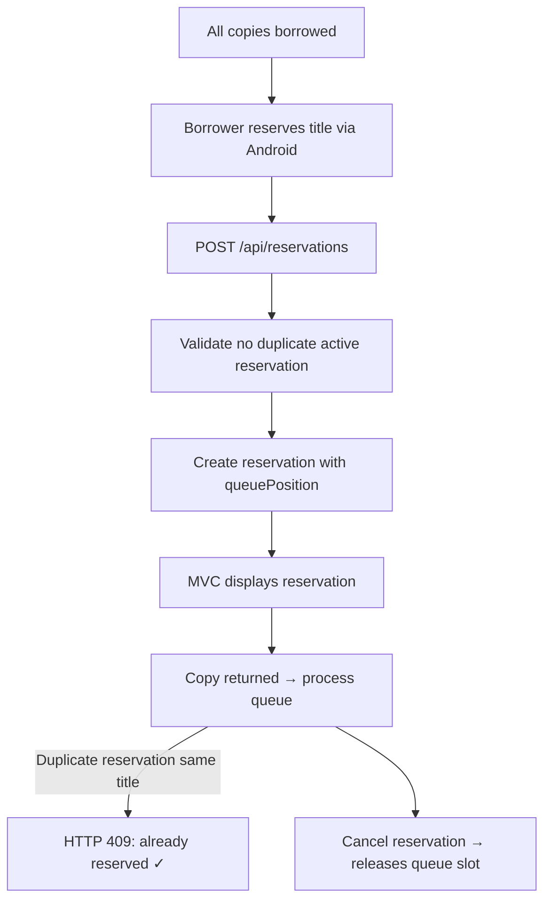
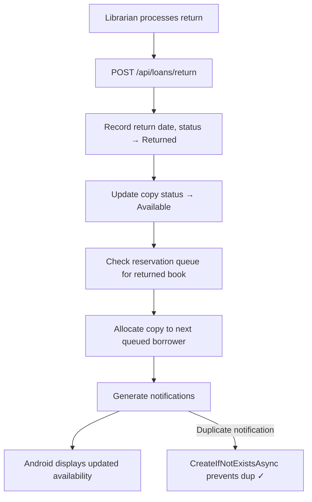
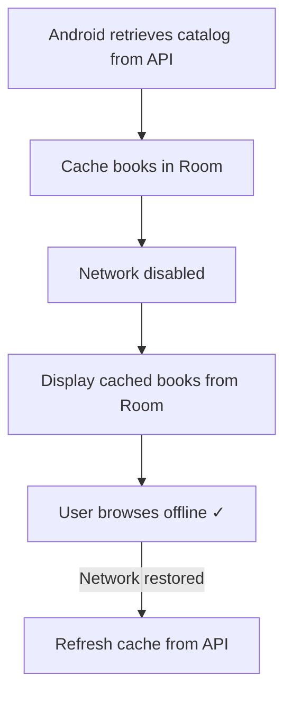
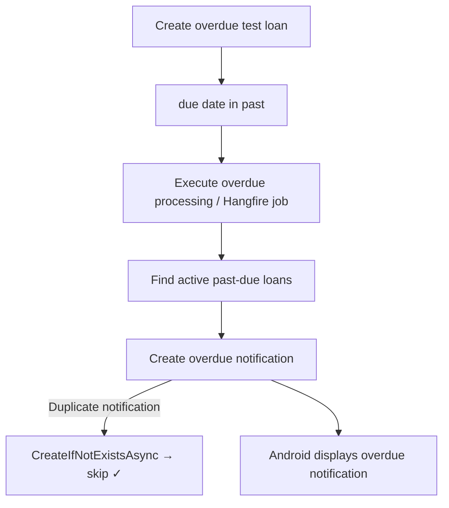
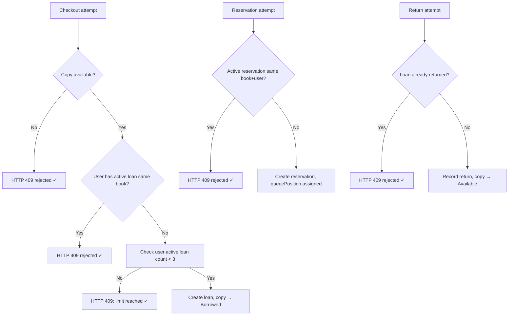

# FLOWCHARTS.md — Milestone 15: End-to-End Integration and Testing

## E2E Test Scenario A: Catalog Synchronization

## E2E Test Scenario B: Borrowing

## E2E Test Scenario C: Reservation

## E2E Test Scenario D: Return and Notifications

## E2E Test Scenario E: Offline Catalog (Android)

## E2E Test Scenario F: Overdue Automation

## Business Invariant Verification

## Acceptance Criteria Summary

| Criterion | Status |
|---|---|
| Catalog sync end-to-end | ✓ Local API works (Open Library external sandbox-blocked) |
| Borrowing with business rules | ✓ Duplicate/limit/unavailable all → 409 |
| Reservation with queue ordering | ✓ Creation, duplicate prevention, cancellation |
| Return with inventory update | ✓ Copy → Available, active loans cleared |
| Notifications | ✓ Overdue + reservation messages generated |
| Offline catalog | ✓ Room cache implemented, build-verified |
| Overdue automation | ✓ Overdue detected, notification generated, dup prevented |
