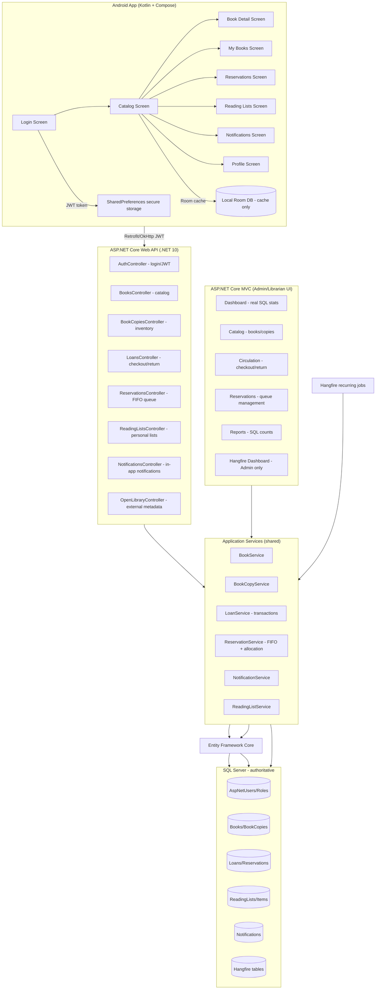
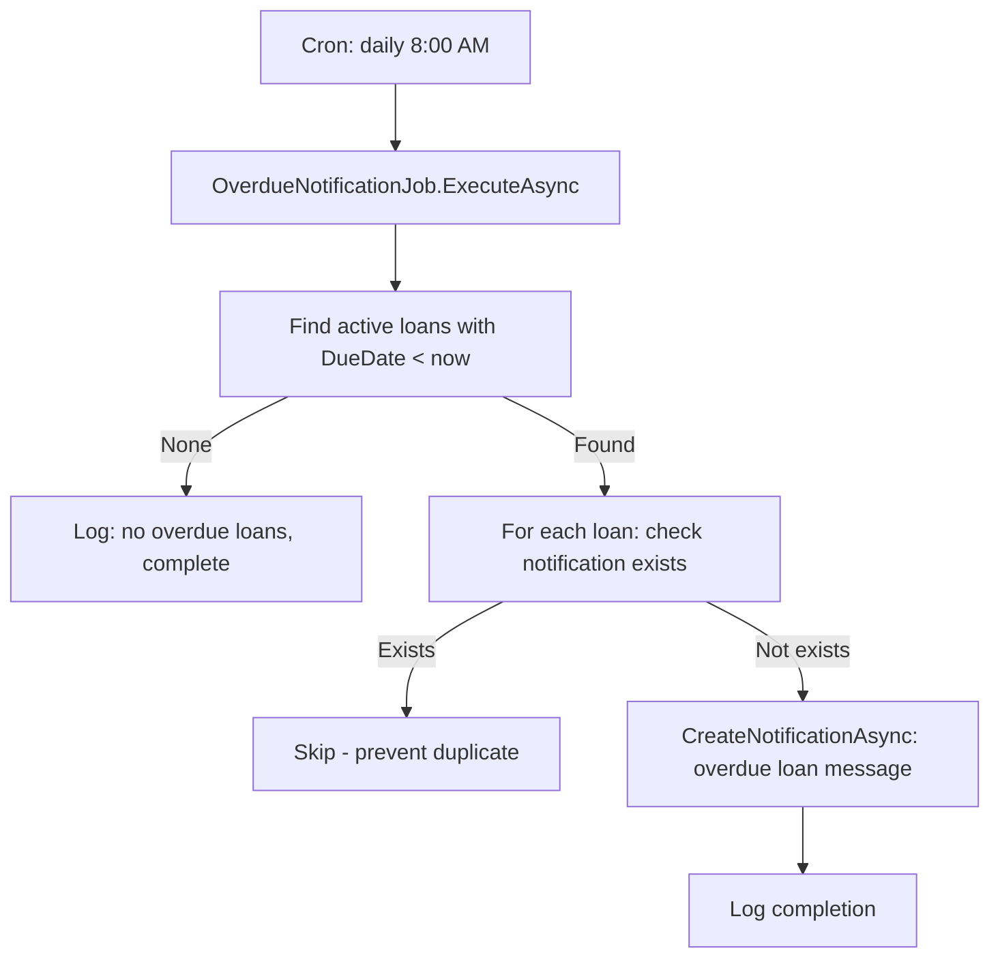
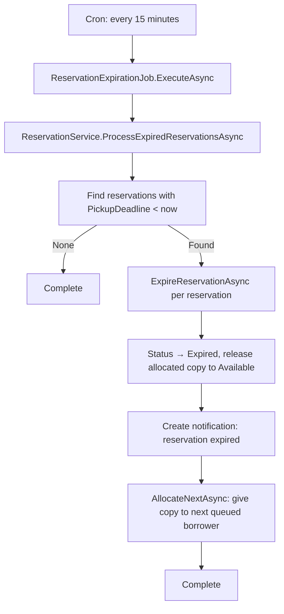

# FLOWCHARTS.md — Milestone 16: Final Review, Documentation, and Demonstration Preparation

## Overall System Architecture



## Authentication & Authorization Flow

```mermaid
flowchart TD
    A[Android login: email + password] --> B[POST /api/Auth/login]
    B --> C[Validate credentials via Identity]
    C -->|Valid| D[Generate JWT (120 min, roles)]
    D -->|Invalid| E[401 Unauthorized]
    C -->|Valid| D
    D --> F[Store JWT in SharedPreferences]
    F --> G[All API calls: Authorization: Bearer <token>]
    G --> H[JWT Bearer validation on server]
    H -->|Role check| I[Authorize attribute per endpoint]
    H -->|Valid| J[Return data]
    H -->|Invalid| K[401/403]

    subgraph MVC["MVC Cookie Auth"]
        L[Login form + antiforgery] --> M[Identity sign-in]
        M --> N[Cookie session]
        N --> O[Role-based [Authorize] on MVC controllers]
    end
```

## Circulation Transaction Flow (Checkout)

```mermaid
flowchart TD
    A[POST /api/loans/checkout] --> B[DbTransaction begins]
    B --> C[Validate user exists]
    C --> D[Validate book exists]
    D --> E[Check duplicate active loan same title]
    E -->|Duplicate| F[409 Conflict - rollback]
    E -->|OK| G[Check active loan count < 3]
    G -->|Limit reached| H[409 Conflict - rollback]
    G -->|OK| I[Find available copy (order by accession)]
    I -->|None| J[409 Conflict - rollback]
    I -->|Found| K[Re-fetch copy with update lock, re-check status]
    K -->|Not available| L[409 Conflict - rollback]
    K -->|Available| M[copy.Status = Borrowed, create Loan]
    M --> N[SaveChanges + Commit]
    N --> O[Return loan response]
```

## Reservation Queue Flow (First-Come, First-Served)

```mermaid
flowchart TD
    A[POST /api/reservations] --> B[DbTransaction begins]
    B --> C[Check duplicate active reservation same book+user]
    C -->|Duplicate| D[409 Conflict - rollback]
    C -->|OK| E[Create reservation Status=Queued, PickupDeadline=+2 days]
    E --> F[Calculate queuePosition = earlier queued + 1]
    F --> G[SaveChanges + Commit]
    
    G --> H[Copy returned → POST /api/loans/return]
    H --> I[copy.Status = Available]
    I --> J[AllocateReturnedCopyAsync(bookId, copyId)]
    J --> K[Find next Queued reservation ordered by ReservedAt]
    K -->|None| L[Copy stays Available]
    K -->|Found| M[copy.Status = Reserved, reservation → ReadyForPickup]
    M --> N[Create notification: ready for pickup]
```

## Overdue Notification Job (Hangfire)



## Reservation Expiration Job (Hangfire)



## Demonstration Workflow

```mermaid
flowchart TD
    A[Start: dotnet run --project src/Sinop.Web] --> B[Android app installed on emulator]
    B --> C[Librarian logs in (web or API)]
    C --> D[View catalog: The Pragmatic Programmer, To Kill a Mockingbird]
    D --> E[Librarian checks out copy LIB-0003 to borrower]
    E --> F[Borrower logs in Android]
    F --> G[Borrower sees active loan in My Books]
    G --> H[Borrower reserves book id=2]
    H --> I[Reservation created, queuePosition=1]
    I --> J[Librarian processes return]
    J --> K[Copy → Available, reservation queue allocates]
    K --> L[Borrower notified: ready for pickup]
    L --> M[Hangfire dashboard: Administrator views recurring jobs]
```

## Acceptance Criteria — Final

| Criterion | Status |
|---|---|
| Backend builds successfully | ✓ 0 errors |
| Android builds successfully | ✓ BUILD SUCCESSFUL, APK produced |
| SQL Server database operational | ✓ Migrations + seeding on startup |
| Seeded accounts work | ✓ All 3 roles verified |
| MVC authentication works | ✓ Cookie auth + antiforgery + roles |
| Android authentication works | ✓ JWT login + bearer on all API calls |
| Swagger functional | ✓ `/swagger/index.html` with JWT |
| Catalog management works | ✓ List/search/details/create/update/archive |
| Physical inventory works | ✓ Accession numbers, status, unique constraint |
| Borrowing and returns work | ✓ Transactions, limits, duplicate prevention |
| Reservations work | ✓ FIFO queue, expiration, allocation |
| Reading lists work | ✓ CRUD, add/remove, ownership |
| Notifications work | ✓ In-app, duplicate prevention |
| Hangfire jobs execute | ✓ Registered: overdue daily 8AM, expiration every 15 min |
| Android caching works | ✓ Room cache, offline-first |
| All apps communicate | ✓ E2E scenarios A-F verified |
